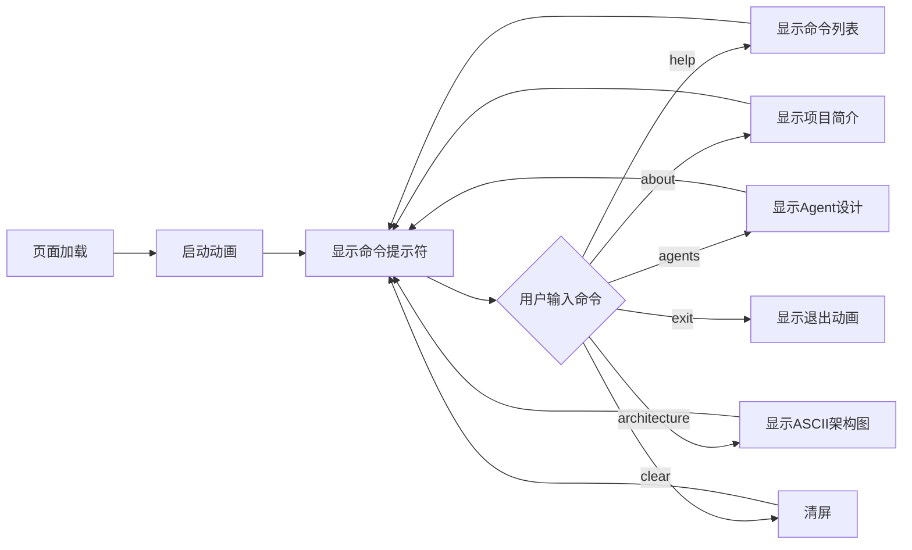

# PRD - Factor Trading CLI 风格介绍展示页面

## 1. 产品概述

为 Factor Trading v3.0 量化回测框架设计一个 CLI（命令行界面）风格的介绍展示页面。
- 目标：以极客/黑客风格展示项目架构、核心功能和设计哲学
- 受众：量化开发者、GitHub 访客、潜在贡献者

## 2. 核心功能

### 2.1 页面模块

1. **终端启动动画**: 模拟终端开机，逐行输出系统信息
2. **交互式命令行**: 用户可输入命令查看不同模块（about, agents, factors, risk, architecture）
3. **动态打字效果**: 所有文本以打字机效果呈现
4. **ASCII 架构图**: 以文本形式展示项目架构
5. **模块详情展示**: 命令响应以终端输出形式展示

### 2.2 支持的命令

| 命令 | 功能 |
|------|------|
| `help` | 显示可用命令列表 |
| `about` | 显示项目简介 |
| `agents` | 显示 Agent 系统设计 |
| `factors` | 显示因子模块功能 |
| `risk` | 显示风险监控设计 |
| `architecture` | 显示项目架构图 |
| `distillation` | 显示蒸馏机制 |
| `reflection` | 显示反思机制 |
| `clear` | 清屏 |
| `exit` | 关闭终端 |

## 3. 核心流程



## 4. 用户界面设计

### 4.1 设计风格

- **主题**: 深色终端风格，黑色背景 (#0d1117)
- **主色**: 绿色终端文字 (#3fb950)，代表成功/输出
- **强调色**: 蓝色 (#58a6ff) 用于链接和提示，黄色 (#d29922) 用于警告
- **字体**: JetBrains Mono（等宽字体），模拟真实终端
- **布局**: 全屏终端窗口，带标题栏和滚动区域
- **光标**: 闪烁的块光标（█）

### 4.2 启动动画序列

1. 黑屏 0.5s
2. 逐行显示 BIOS 风格信息（内存检测、CPU 信息）
3. 显示 "Factor Trading v3.0 [OK]"
4. 显示命令提示符 `user@factor-trading:~$`

### 4.3 命令响应样式

```
user@factor-trading:~$ about

┌─────────────────────────────────────────┐
│  Factor Trading v3.0                    │
│  专业量化回测框架                        │
├─────────────────────────────────────────┤
│  Version: 3.1                           │
│  License: MIT                           │
│  Python: 3.10+                          │
└─────────────────────────────────────────┘

> 基于 Backtest_Opus_2.0 架构重构
> 专为 A 股市场设计
> 228+ 测试用例保障质量

user@factor-trading:~$ █
```

### 4.4 交互细节

- **Tab 补全**: 输入 `ag` 按 Tab 补全为 `agents`
- **历史记录**: 上下箭头切换历史命令
- **滚动**: 输出超过屏幕时自动滚动
- **响应式**: 移动端适配为简化版终端

## 5. 技术约束

- 纯 HTML/CSS/JS，无框架依赖
- 使用 CSS 动画实现打字效果
- 本地存储记录命令历史
- 支持键盘快捷键（Ctrl+L 清屏，Ctrl+C 中断）
